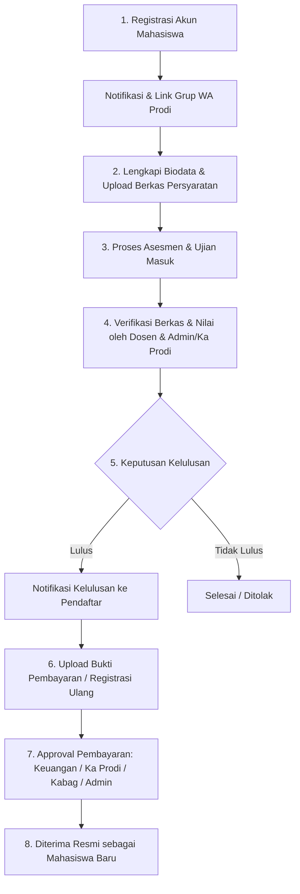

# Feature Plan: Sistem PMB (Penerimaan Mahasiswa Baru) - RBAC Scoped & Alur Seleksi

Dokumen ini berisi spesifikasi arsitektur dan panduan implementasi tingkat tinggi (*high-level planning*) untuk modul inti PMB. Dokumen ini dirancang sebagai acuan kerja bagi programmer atau agen AI pelaksana agar dapat diimplementasikan secara terstruktur, modular, dan minim ambiguitas.

---

## 1. Ringkasan Kebutuhan & Konsep Desain

Aplikasi PMB menangani alur penerimaan calon mahasiswa mulai dari pendaftaran akun, seleksi berkas & asesmen, hingga pembayaran dan penetapan status diterima.

### Prinsip Utama:
1. **RBAC Standar:** Menggunakan package `spatie/laravel-permission` (`roles` dan `permissions`).
2. **Scope Akses Berbasis Data (`user_access`):**
   * Role internal tidak boleh diduplikasi per prodi (misal: **tidak boleh** membuat role `admin_prodi_ip`, `admin_prodi_hi`, dst.).
   * Cukup satu role umum (misal: `admin_prodi`, `ka_prodi`, `dosen`).
   * Batasan akses ke data prodi ditentukan melalui tabel relasi `user_access` yang menghubungkan `user_id` dengan `study_program_id`.
3. **Pemisahan Interface:**
   * **Portal Mahasiswa (Breeze):** Untuk pendaftar/calon mahasiswa (pendaftaran, upload berkas, monitoring status, upload bukti bayar).
   * **Panel Manajemen/Admin (Filament PHP):** Untuk civitas akademika dan staf (Super Admin, Dekan, Ka Bag, Keuangan, Ka Prodi, Admin Prodi, Dosen).

---

## 2. Struktur Role & Lingkup Akses (Scope)

### A. Daftar 10 Role Pengguna
| No | Nama Role (`name`) | Lingkup Akses Data | Deskripsi Tugas Utama |
|---|---|---|---|
| 1 | `super_admin` | Global (Semua Prodi & Konfigurasi) | Konfigurasi sistem, master data, user & role management |
| 2 | `admin_fakultas` | Seluruh Prodi di Fakultas | Pengawasan pendaftaran seluruh fakultas & approval tingkat fakultas |
| 3 | `dekan` | Seluruh Prodi di Fakultas | Monitoring eksekutif & laporan penerimaan mahasiswa baru |
| 4 | `wakil_dekan` | Seluruh Prodi di Fakultas | Monitoring pendaftaran, asesmen, dan penetapan kuota |
| 5 | `kabag_tu` | Seluruh Prodi di Fakultas | Verifikasi administratif & approval akhir registrasi |
| 6 | `keuangan` | Global / Seluruh Fakultas | Verifikasi dan approval bukti pembayaran biaya pendaftaran & UKT |
| 7 | `admin_prodi` | Terbatas pada Prodi terkait (`user_access`) | Administrasi berkas pendaftar prodi, link WA grup prodi, support operasional |
| 8 | `ka_prodi` | Terbatas pada Prodi terkait (`user_access`) | Approval kelulusan asesmen & verifikasi akhir mahasiswa di prodinya |
| 9 | `dosen` | Terbatas pada Prodi terkait (`user_access`) | Pelaksana asesmen/ujian/wawancara dan review berkas pendaftar |
| 10 | `mahasiswa` | Terbatas pada data miliknya sendiri | Mengisi formulir, mengunggah berkas & bukti bayar |

### B. Master Program Studi Awal (Scope Target)
1. **Prodi IP** (Ilmu Pemerintahan - S1)
2. **Prodi HI** (Hubungan Internasional - S1)
3. **Prodi MIP** (Magister Ilmu Pemerintahan - S2)
4. **Prodi MHI** (Magister Hubungan Internasional - S2)
5. **Prodi Doktor IP** (Doktor Ilmu Pemerintahan - S3)

---

## 3. Alur Proses Bisnis PMB (State Machine)

Alur pendaftaran pendaftar mengikuti siklus hidup (*lifecycle*) status berikut:

### Rincian Tahapan & Status Registrasi:
1. `draft`: Calon mahasiswa membuat akun dan memilih prodi yang dituju.
2. `submitted`: Formulir biodata disimpan dan seluruh berkas wajib diunggah.
   * **Trigger:** Sistem menampilkan/mengirimkan tautan Grup WhatsApp resmi prodi tujuan.
3. `assessing`: Berkas masuk ke tahap penilaian/asesmen (dosen/tim seleksi prodi memberikan skor/catatan asesmen).
4. `verified`: Berkas dan hasil asesmen telah diverifikasi bersama oleh Dosen Penguji dan Admin/Ka Prodi.
5. `announced_passed` / `rejected`:
   * Status kelulusan diumumkan ke akun pendaftar (dilengkapi notifikasi email/dashboard banner).
6. `payment_pending`: Pendaftar yang lulus mengunggah bukti pembayaran daftar ulang / UKT.
7. `payment_verified`: Bukti pembayaran disetujui oleh tim Keuangan / Kabag TU / Ka Prodi.
8. `accepted`: Status final, pendaftar resmi dinyatakan diterima.

---

## 4. Desain Database & Skema Data (High-Level)

### 1. `faculties` & `study_programs` (Master Data)
* `faculties`: `id`, `name`, `code`
* `study_programs`: `id`, `faculty_id`, `name`, `code`, `degree` (S1/S2/S3), `wa_group_url` (tautan grup WA spesifik prodi)

### 2. `user_access` (Multi-Scope Tenancy)
* Menghubungkan user staf dengan prodi yang menjadi wewenangnya:
  * `id`, `user_id`, `study_program_id`, `created_at`, `updated_at`
  * *Constraint:* Unique per pasangan `(user_id, study_program_id)`.
  * *Aturan:* Staf ber-role `admin_prodi`, `ka_prodi`, atau `dosen` hanya dapat melihat pendaftar yang memilih `study_program_id` yang terdaftar pada tabel ini.

### 3. `registrations` (Entitas Utama Pendaftaran)
* `id`, `registration_number` (format unik, misal: `PMB-2026-XXXX`)
* `user_id` (relasi ke tabel `users` calon mahasiswa)
* `study_program_id` (relasi ke `study_programs`)
* `status` (enum: `draft`, `submitted`, `under_review`, `assessing`, `passed`, `rejected`, `payment_submitted`, `accepted`)
* `notes` (catatan tim penyeleksi untuk pendaftar jika ada berkas yang perlu revisi)
* Timestamps

### 4. `media` (Berkas Persyaratan via Spatie MediaLibrary)
* Koleksi berkas pendaftar dikaitkan ke model `Registration`:
  * Collection `ktp`, `ijazah`, `transkrip_nilai`, `pas_foto`, `dokumen_pendukung`
  * Collection `bukti_pembayaran` (diunggah pada fase daftar ulang)

### 5. `assessments` (Penilaian Asesmen)
* `id`, `registration_id`, `assessor_id` (`user_id` Dosen), `score`, `evaluation_notes`, `recommendation` (Lulus / Tidak Lulus / Cadangan)

### 6. `payment_confirmations` (Konfirmasi Pembayaran)
* `id`, `registration_id`, `amount`, `payment_date`, `verified_by` (`user_id`), `verification_status` (`pending`, `approved`, `rejected`), `verified_at`

---

## 5. Rencana Tahapan Eksekusi (Phased Roadmap)

### Fase 1: Master Data & Scoping Table
1. Buat migration & model untuk `faculties`, `study_programs` (tambahkan kolom `wa_group_url`), dan `user_access`.
2. Buat Seeder:
   * Data master prodi (IP, HI, MIP, MHI, Doktor IP).
   * 10 role pada Spatie Permission.
   * Seeder akun dummy untuk tiap role dan hubungkan akun dosen/admin prodi ke prodi masing-masing di `user_access`.
3. Buat Trait/Scope Helper pada model `User`:
   * Method untuk mengecek prodi apa saja yang dimiliki user: `$user->accessibleStudyProgramIds()`.

### Fase 2: Portal Pendaftar (Mahasiswa - Breeze)
1. Buat halaman alur pendaftaran mahasiswa pada frontend Breeze:
   * **Langkah 1:** Pemilihan program studi & pengisian formulir biodata.
   * **Langkah 2:** Integrasi notifikasi & tampilan kartu/link **Grup WhatsApp prodi** setelah form awal disimpan.
   * **Langkah 3:** Halaman upload dokumen berkas persyaratan menggunakan Spatie MediaLibrary.
   * **Langkah 4:** Halaman cek pengumuman status kelulusan.
   * **Langkah 5:** Halaman upload bukti pembayaran pendaftaran ulang.

### Fase 3: Filament Panel & Query Scoping
1. Buat Filament Resource:
   * `StudyProgramResource` (Master prodi & konfigurasi link WA grup, hanya untuk Super Admin & Dekanat).
   * `UserAccessResource` (Pengaturan penugasan prodi untuk staf/dosen).
   * `RegistrationResource` (Pusat manajemen data pendaftar).
2. **Implementasi Query Scoping pada Filament:**
   * Di `RegistrationResource::getEloquentQuery()`, jika user bukan Super Admin / Dekanat / Keuangan, filter pendaftar hanya pada `study_program_id` yang ada di `user_access` milik user login.
3. Terapkan policy Laravel (`RegistrationPolicy`) untuk mengunci hak create/update/view berdasarkan `user_access` dan role.

### Fase 4: Modul Asesmen & Verifikasi Berkas
1. Di panel Filament, sediakan aksi (*Action/Form*) bagi Dosen & Ka Prodi:
   * Review preview berkas pendaftar langsung di browser.
   * Form input nilai asesmen dan rekomendasi keputusan seleksi.
2. Buat aksi validasi berkas oleh Admin Prodi & Ka Prodi.
3. Buat aksi penetapan status kelulusan (`passed` / `rejected`).

### Fase 5: Modul Pembayaran & Final Acceptance
1. Mahasiswa mengunggah slip pembayaran pada portal Breeze.
2. Tim Keuangan / Kabag TU / Ka Prodi melihat notifikasi pembayaran masuk di Filament:
   * Aksi `Approve Payment` atau `Reject Payment` (dengan alasan jika slip tidak valid).
3. Setelah pembayaran disetujui, pendaftar mendapatkan status `accepted` (Diterima Resmi) dan dapat mencetak bukti tanda terima (menggunakan `barryvdh/laravel-dompdf`).

---

## 6. Checklist Kriteria Selesai (Acceptance Criteria)

- [ ] Tabel `faculties`, `study_programs`, dan `user_access` terbuat dan terhubung secara relasional.
- [ ] 10 Role terdaftar di sistem dengan izin akses yang sesuai.
- [ ] User dengan role `admin_prodi`, `ka_prodi`, dan `dosen` hanya dapat melihat dan menilai data mahasiswa dari prodi yang terdaftar di `user_access`.
- [ ] Calon mahasiswa dapat mendaftar, memilih prodi, dan langsung melihat tautan grup WA prodi tujuannya.
- [ ] Berkas persyaratan tersimpan rapi menggunakan Spatie MediaLibrary dan dapat ditinjau oleh verifikator.
- [ ] Dosen & Ka Prodi dapat menginput asesmen dan mengubah status kelulusan.
- [ ] Calon mahasiswa yang lulus dapat mengunggah bukti bayar, dan bagian Keuangan/Ka Prodi/Kabag dapat melakukan approval.
- [ ] Status akhir mahasiswa berubah menjadi `accepted` setelah seluruh proses approval pembayaran selesai.

